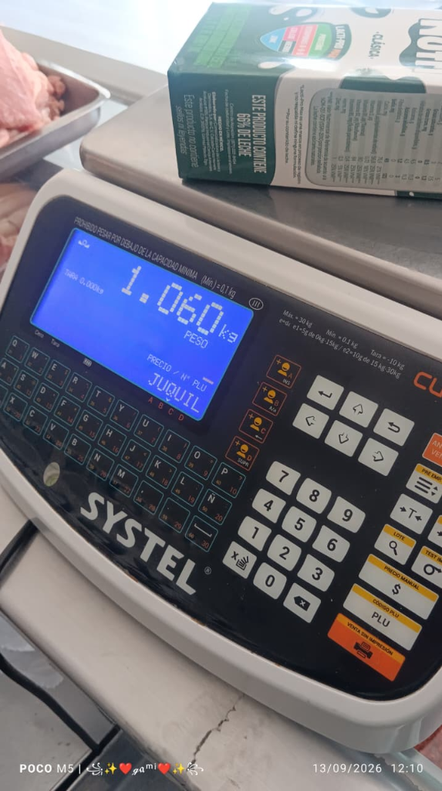
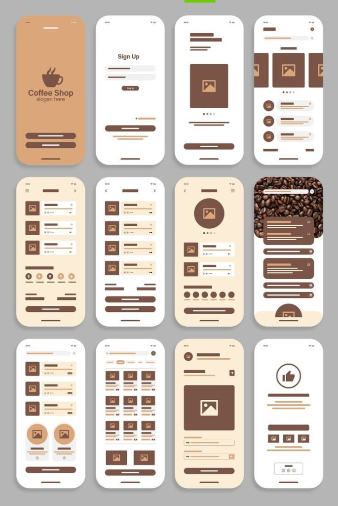
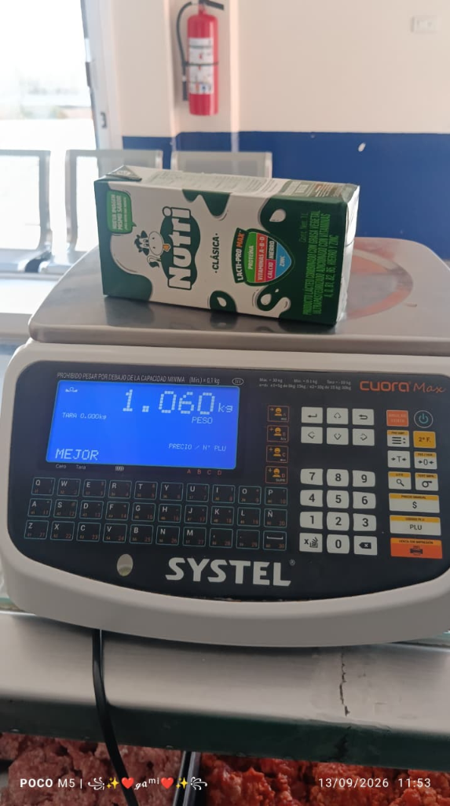

<div align="center">


# SGNIA Carnicería & Balanza Industrial POS
### *“Software que Protege y Hace Crecer tu Negocio”*

Sistema nativo Android de alto rendimiento para el control operativo de carnicerías, salas de despiece y rastros, integrando pesaje continuo multiescala por TCP/IP, punto de venta fuera de línea y consola administrativa para propietarios.

[](CHANGELOG.md)
[](app/build.gradle.kts)
[](build.gradle.kts)
[](gradle/libs.versions.toml)
[](#7-arquitectura-técnica)
[](LICENSE)
[](#10-pruebas-automatizadas)

</div>

---

## Índice

1. [Problema que Resuelve](#1-problema-que-resuelve)
2. [Funciones Principales por Rol](#2-funciones-principales-por-rol)
3. [Hardware y Básculas Compatibles](#3-hardware-y-básculas-compatibles)
4. [Capturas de Pantalla del Sistema](#4-capturas-de-pantalla-del-sistema)
5. [Instalación y Puesta en Marcha](#5-instalación-y-puesta-en-marcha)
6. [Guía de Inicio Rápido](#6-guía-de-inicio-rápido)
7. [Arquitectura Técnica](#7-arquitectura-técnica)
8. [Estructura del Proyecto](#8-estructura-del-proyecto)
9. [Sistema de Diseño Noir & Crema](#9-sistema-de-diseño-noir--crema)
10. [Pruebas Automatizadas](#10-pruebas-automatizadas)
11. [Seguridad y Limitaciones Conocidas](#11-seguridad-y-limitaciones-conocidas)
12. [Privacidad y Marco Legal](#12-privacidad-y-marco-legal)
13. [Hoja de Ruta](#13-hoja-de-ruta)
14. [Licencia](#14-licencia)
15. [Créditos y Contacto](#15-créditos-y-contacto)

---

## 1. Problema que Resuelve

En el comercio cárnico tradicional, el pesaje manual y el control deficiente de mermas generan pérdidas económicas constantes. SGNIA digitaliza y automatiza el flujo operativo completo:

| Desafío Operativo Tradicional | Solución Implementada en SGNIA | Impacto Técnico y Comercial |
| :--- | :--- | :--- |
| **Digitación manual de peso**: El cajero teclea el peso a la vista, propiciando errores humanos y redondeos involuntarios. | **Lectura directa TCP/IP**: Captura automática del peso bruto/neto directo del procesador de la báscula al tocar el corte. | Cero discrepancias entre plato de pesaje y registro en ticket. |
| **Pérdida por corte de internet**: Los sistemas en la nube se detienen si falla el proveedor de enlace o dentro de cámaras frías. | **Arquitectura Offline-First Nativa**: Toda la lógica transaccional, base de datos Room SQLite y comunicación de hardware opera en red de área local (LAN). | Operación ininterrumpida las 24 horas sin depender de conectividad externa. |
| **Descontrol en mermas de canal**: Desconocimiento del porcentaje real de hueso, grasa y sebo resultante del despiece. | **Módulo de rendimiento de despiece**: Cálculo de mermas esperadas frente a peso real de salida con derivación de subcortes. | Monitoreo del margen de utilidad real por canal o cuarto de res/cerdo. |
| **Consolidación caótica de pedidos**: Pedidos por mensajes informales o libretas entre múltiples carnicerías. | **Consola Dueño con Unificación Maestra**: Agrupación matemática de pedidos de todas las sucursales con redondeo a cajas cerradas. | Generación de orden unificada para el rastro en PDF y mensaje formal para WhatsApp. |
| **Fuga de productos secundarios**: Dificultad para registrar productos que son inversión propia del encargado (botanas, especias, bolsas). | **Módulo independiente de Inversión Local**: Registro separado de productos embolsados con proyección de utilidad propia. | Transparencia total entre el inventario del negocio y los artículos del encargado. |
| **Actualización lenta de catálogo**: Alta manual producto por producto en cada terminal de tienda. | **Importador Qendra (.txt, .csv y TCP socket)**: Carga masiva de códigos PLU, tara y descripción en segundos. | Estandarización de catálogo entre terminales y software empresarial preexistente. |

---

## 2. Funciones Principales por Rol

El sistema cuenta con dos aplicaciones independientes (compiladas mediante `productFlavors`):

### 🥩 Perfil Encargado (SGNIA Carnicería POS — Mostrador)
* **Visor Multiescala Dinámico**: Monitoreo en vivo de 1 a 10 básculas en tarjetas Bento con tara individual, selector de estabilidad y discriminación de estado de enlace (indicador "SIN CONEXIÓN" en `#E07A6F` y peso `"--.---"` si el socket no responde).
* **Aprovechamiento de Espacio con Historial Rápido**: En configuraciones de 1 o 2 básculas, el visor integra automáticamente una tarjeta con los últimos pesajes capturados.
* **Teclado Numérico de Peso Manual**: Modal táctil para ingresar pesos manualmente ante emergencias de hardware o piezas pre-pesadas.
* **Lector Óptico de Códigos de Barras y QR**:
  * Escaneo por cámara integrada con **CameraX** y **Google ML Kit**.
  * Soporte para lectores físicos (pistolas láser USB y Bluetooth en modo HID).
  * Parser especializado para códigos EAN-13 cárnicos con peso o precio embebido.
* **Módulo de Despiece y Rendimiento**: Registro de peso de entrada de canales, pesado de cortes limpios y cálculo automático de mermas y porcentaje de merma.
* **Inversión Propia del Encargado (Botanas y Embolsados)**: Control aislado de productos empacados, piezas por bolsa, existencias actuales y cálculo de valor proyectado sin mezclar las finanzas del negocio.
* **Auditoría Histórica de Precios**: Visualización del registro local de cambios de tarifas para validar precios actualizados.
* **Recepción de Mercancía**: Validación de peso de proveedores y entrada a almacén.
* **Servicio de Red en Segundo Plano**: Foreground Service con `WifiLock` y `WakeLock` para sostener los sockets TCP abiertos aunque la pantalla del dispositivo se apague.
* **Activación de Licencia Offline**: Diálogo para validar llaves criptográficas de activación con duraciones demostrativas (`10M`, `07D`), temporales (`01M`, `01Y`) o perpetuas (`LIFE`).
* **Documentos Legales Integrados**: Acceso en terminal a Términos de Servicio y pantalla institucional "Acerca de".

### 👔 Perfil Dueño (SGNIA Consola Dueño — Supervisión)
* **Unificación Maestra de Pedidos Multi-Tienda**: Sumatoria consolidada de requerimientos de producto de todas las sucursales asociadas, con cálculo de faltantes y redondeo automático a cajas completas.
* **Exportación Formal**: Generación de reportes de pedidos en formato PDF y envío estructurado a proveedores vía WhatsApp.
* **Directorio de Sucursales y Proveedores**: Administración de tiendas vinculadas, nombres de encargados, números de contacto y frigoríficos asociados.
* **Control de Acceso por PIN**: Validación de credenciales de 4 dígitos para delimitar el acceso a configuraciones de red y márgenes comerciales.
* **Sincronización en la Nube (Opcional)**: Enlace con base de datos PostgreSQL alojada en Supabase para consulta remota en tiempo real.

---

## 3. Hardware y Básculas Compatibles

La comunicación con las básculas se gestiona mediante sockets TCP/IP crudos sobre redes Wi-Fi o Ethernet local:

| Marca | Modelos | Puerto | Protocolo / Implementación | Estado de Validación |
| :--- | :--- | :---: | :--- | :---: |
| **Systel** | Cuora Max, Cuora Neo | `10001` | Binario V7.0/V6.2 (Función 1: Solicitud de Peso, Función 2: Firma, Función 31/62: Catálogo PLU, CRC XOR) | **Probado en hardware real y suites de prueba** |
| **Systel** | Cuora 2 | `10001` | Binario V4.0 (Función 3: PLU 4 dígitos, CRC XOR) | **Probado en hardware real y suites de prueba** |
| **Systel** | Croma, Brio | `10001` | ASCII Continuo estándar | Soporte por protocolo [VERIFICAR] |
| **Torrey** | L-EQ 5/10/20, MFQ | `5000` | Sondeo por comando carácter `'W'` (`0x57`) | Implementado por protocolo [VERIFICAR] |
| **Torrey** | W-LABEL 20/40, PCR | `5000` / `9001` | Trama ASCII continua / comando `'P'` | Implementado por protocolo [VERIFICAR] |
| **Rhino** | BAR-8, BAR-9, BAC-300 | `10001` | Lectura de flujo ASCII continuo | Implementado por protocolo [VERIFICAR] |
| **Mettler Toledo** | Viva, Tiger 15D, 8217 | `10001` | Protocolo estándar MT-SICS (`'S\r\n'`) | Implementado por protocolo [VERIFICAR] |
| **CAS** | PD-II POS, CL-5000 | `10001` | Estándar CAS ASCII | Implementado por protocolo [VERIFICAR] |
| **Dibatec** | Serie Industrial | `10001` | Lectura de trama continua | Implementado por protocolo [VERIFICAR] |
| **Yaohua** | XK3190-A12E | `10001` | Formato continuo para básculas de plataforma de gancho | Implementado por protocolo [VERIFICAR] |
| **Genérica** | Convertidor Serial a Ethernet/Wi-Fi | Configurable | Expresiones regulares tolerantes para cadenas de peso | Implementado por protocolo [VERIFICAR] |

> **Nota de ingeniería**: El protocolo binario Systel cuenta con validación de tramas binarias completas, checksums XOR y pruebas de integración. Para el resto de fabricantes, el sistema incluye parsers basados en sus especificaciones técnicas de fábrica; su puesta en marcha en campo requiere calibrar la velocidad de sondeo y delimitadores específicos del modelo.

---

## 4. Capturas de Pantalla del Sistema

El sistema emplea un diseño ergonómico de alto contraste con tarjetas Bento para entornos industriales y cuartos fríos:

| 01. Visor de Básculas en Red | 02. Catálogo de Cortes y PLUs |
| :---: | :---: |
|  |  |
| *Monitoreo en vivo con tarjeta de peso, botón de tara (64 dp) y selector de estabilidad.* | *Catálogo con precio por kilo, código PLU, unidades de presentación y existencias.* |

| 03. Entradas y Despiece Cárnico | 04. Pedidos y Requisiciones |
| :---: | :---: |
|  |  |
| *Recepción de canales, balance de mermas y porcentaje de rendimiento de subcortes.* | *Requisición con redondeo a cajas cerradas y exportación formal a PDF / WhatsApp.* |

| 05. Inversión Propia del Encargado | 06. Ajustes y Zona de Peligro |
| :---: | :---: |
|  |  |
| *Control de botanas y artículos embolsados sin mezclar finanzas del negocio.* | *Gestión de sockets TCP/IP y zona de peligro protegida con doble confirmación.* |

| 07. Activación de Licencias Offline | 08. Acerca de SGNIA Company |
| :---: | :---: |
|  |  |
| *Activación criptográfica por hardware ID para demos, rentas y licencias perpetuas.* | *Ficha de arquitectura, canales oficiales de soporte técnico y términos de uso.* |

---

## 5. Instalación y Puesta en Marcha

### Para Usuarios Finales (Operación en Tienda)
1. **Requisitos de Dispositivo**:
   * Tablet o teléfono inteligente con **Android 7.0 (Nougat, API 24)** o superior.
   * Recomendado: Android 11+ con pantalla táctil de 8 a 10 pulgadas para uso en mostrador.
   * Conexión Wi-Fi o adaptador Ethernet conectado a la misma red local que las básculas.
2. **Instalación**:
   * Copiar el archivo APK de la variante correspondiente (`tienda` o `dueno`) al dispositivo.
   * Habilitar la opción "Instalar aplicaciones de fuentes desconocidas" en los ajustes de seguridad de Android.
   * Abrir el instalador y aceptar los permisos requeridos (Cámara para escáner, Notificaciones y Almacenamiento).

### Para Desarrolladores (Compilación desde Código Fuente)
1. **Requisitos del Entorno**:
   * **Android Studio**: Ladybug (2024.2.1) o superior.
   * **JDK**: Java Development Kit versión 17.
   * **Android SDK**: `compileSdk = 36`, `minSdk = 24`, `targetSdk = 36`.
   * **Gradle Wrapper**: 9.0.1.
2. **Clonación y Preparación**:
   ```powershell
   git clone https://github.com/Gamavg06/SGNIA_Inventary.git
   cd SGNIA_Inventary
   ```
3. **Compilación de las Variantes**:
   ```powershell
   # SGNIA Carnicería POS (Tablet de Mostrador)
   ./gradlew assembleTiendaDebug

   # SGNIA Consola Dueño (Dispositivo del Propietario)
   ./gradlew assembleDuenoDebug

   # SGNIA Keygen Admin (Panel del Desarrollador)
   ./gradlew :keygen:assembleDebug
   ```

---

## 6. Guía de Inicio Rápido

1. **Configuración de Red de Básculas**:
   * Conectar la tablet y las básculas a la misma red Wi-Fi o switch Ethernet (ej. segmento `192.168.100.x`).
   * En SGNIA POS, acceder a **Ajustes > Red de Básculas** y presionar **Agregar Báscula**.
   * Especificar la dirección IP (ej. `192.168.100.52`) y puerto (`10001` para Systel Cuora).
   * Probar la conectividad mediante el botón **Verificar Ping**.
2. **Operación en Mostrador**:
   * En el **Visor de Básculas**, el equipo activo muestra el peso en vivo. Si el cable o la red se desconectan, el sistema alerta de inmediato con el estado `"SIN CONEXIÓN"` en rojo `#E07A6F` y peso `"--.---"`.
   * Para realizar un pesaje, colocar el producto en el plato y presionar **Capturar** (botón de 64 dp optimizado para trabajo rudo).
   * Para tarar contenedores o charolas, presionar **>0< Tara**.
3. **Cierre de Pedidos y Recepción**:
   * Ingresar a **Pedidos** para revisar los faltantes sugeridos según el stock meta y generar la orden de compra consolidada.

---

## 7. Arquitectura Técnica

El sistema implementa una arquitectura modular desacoplada con flujos reactivos basados en corrutinas de Kotlin:

```
┌────────────────────────────────────────────────────────┐
│                   CAPA DE PRESENTACIÓN                 │
│         Jetpack Compose + StateFlow + Navigation       │
│  (IndustrialScaleVisor, StockReception, OrdersScreen)   │
└───────────────────────────▲────────────────────────────┘
                            │ Flujo bidireccional UI State
┌───────────────────────────┴────────────────────────────┐
│                    CAPA DE NEGOCIO                     │
│                  InventoryViewModel                    │
│      (Cálculo de mermas, pedidos, transacciones)       │
└───────────────────────────▲────────────────────────────┘
                            │
              ┌─────────────┴─────────────┐
              │                           │
┌─────────────▼─────────────┐ ┌───────────▼──────────────┐
│     CAPA DE DATOS         │ │     CAPA DE HARDWARE     │
│   Room Database (SQLite)  │ │     TcpScaleManager      │
│   InventoryRepository     │ │  (Sockets TCP/IP no bloq)│
│  Offline-First Sync       │ │  Foreground Service      │
└───────────────────────────┘ └──────────────────────────┘
```

---

## 8. Estructura del Proyecto

```
SGNIA_Inventary/
├── app/                                  # Módulo principal de la aplicación
│   ├── src/
│   │   ├── main/java/.../inventariocarniceria/
│   │   │   ├── data/
│   │   │   │   ├── local/                # Entidades y DAOs de Room SQLite
│   │   │   │   ├── repository/           # InventoryRepository
│   │   │   │   ├── scale/                # Parsers de trama binaria y catálogo
│   │   │   │   ├── security/             # AppSecurityGuard (Anti-Root, Anti-Frida)
│   │   │   │   └── sync/                 # Conector opcional a Supabase PostgreSQL
│   │   │   ├── service/                  # ScaleBackgroundService (Foreground Service)
│   │   │   ├── theme/                    # SgniaTheme (sistema activo Noir & Crema)
│   │   │   └── ui/                       # Vistas Jetpack Compose
│   │   │       ├── components/           # Escáner CameraX, modales y botones
│   │   │       ├── design/               # Tokens oficiales NoirTokens.kt
│   │   │       ├── screens/              # Pantallas operativas y administrativas
│   │   │       └── viewmodel/            # ViewModels con flujos StateFlow
│   │   ├── tienda/                       # Variante: SGNIA Carnicería POS (Mostrador)
│   │   └── dueno/                        # Variante: SGNIA Consola Dueño (Propietario)
│   │   └── test/                         # 44 pruebas unitarias automatizadas
│   └── build.gradle.kts                  # Configuración de compilación de app
├── keygen/                               # Módulo independiente: SGNIA Keygen Admin
│   ├── src/main/java/.../sgniakeygen/    # Emisor de licencias y contratos PDF
│   └── build.gradle.kts                  # Configuración de compilación de keygen
├── docs/                                 # Documentación técnica y manuales en PDF
│   ├── Arquitectura_Tecnica_SGNIA.pdf    # Manual de ingeniería de software
│   ├── Manual_Conectividad_Basculas_SGNIA.pdf # Manual de configuración de balanzas
│   ├── Manual_Licenciamiento_Ventas_SGNIA.pdf # Manual operativo del Keygen
│   └── Ficha_Tecnica_General_SGNIA.pdf   # Resumen técnico maestro
├── screenshots/                          # Capturas del sistema en ejecución
├── CHANGELOG.md                          # Registro formal de versiones y cambios
├── LICENSE                               # Licencia comercial propietaria
└── README.md                             # Documentación principal del repositorio
```

---

## 9. Sistema de Diseño Noir & Crema

La aplicación se rige bajo un único sistema visual industrial: **Noir & Crema**, formalizado en [`NoirTokens.kt`](app/src/main/java/com/example/inventariocarniceria/ui/design/NoirTokens.kt).

> **Estado del diseño**: Los temas legacy `OBSIDIAN_GOLD` y `CYBER_VIOLET` se encuentran marcados como **[DEPRECADOS / PENDIENTES DE RETIRO DEFINITIVO]**. La interfaz operativa utiliza exclusivamente la paleta Noir & Crema.

| Token de Color | Valor Hexadecimal | Uso Normativo en la Interfaz |
| :--- | :---: | :--- |
| `Background` | `#0F0E0D` | Fondo general de pantalla (máximo contraste y bajo consumo OLED). |
| `Surface` | `#181715` | Superficie base de tarjetas Bento y diálogos. |
| `SurfaceRaised` | `#1F1D1A` | Tarjetas activas, barras superiores y contenedores secundarios. |
| `SurfaceSunken` | `#121110` | Fondos de campos de texto y filas alternas de tablas. |
| `Hairline` / `Border` | `#2A2723` / `#3A352F` | Delimitadores estructurales tenues para definición de cuadrículas. |
| `Cream` | `#EEDDC8` | Acento primario, botones de acción principal y bordes al enfocar. |
| `TextPrimary` | `#F3EFE6` | Tipografía principal para nombres de producto y pesos activos. |
| `TextSecondary` | `#A8A196` | Subtítulos, unidades de medida y etiquetas secundarias. |
| `TextMuted` | `#9E968A` | Textos descriptivos (contraste verificado según WCAG AA). |
| `Emerald` | `#4ADE80` | **Exclusivo para estados positivos**: peso estable y báscula en línea. |
| `Amber` / `Gold` | `#D9A441` / `#C9A96E` | Estados transitorios de lectura de peso, monedas e insignias. |
| `Danger` | `#E07A6F` | **Exclusivo para estados críticos**: báscula desconectada, error o zona de peligro. |

* **Ergonomía Táctil Industrial**: Todos los botones de captura de peso y acciones críticas cumplen con un área táctil mínima de **64 dp** (`NoirSpace.touch`), permitiendo operación certera con manos húmedas o guantes de carnicería. Los botones secundarios respetan un mínimo de **48 dp**.

---

## 10. Pruebas Automatizadas

El proyecto cuenta con **44 pruebas unitarias independientes** que se ejecutan sin dependencias de emulador:

```powershell
# Ejecución de la suite completa de pruebas unitarias
./gradlew testDebugUnitTest
```

### Cobertura de las Pruebas Unitarias
1. **Protocolo y Tramas de Báscula** (`ScaleFrameParserTest.kt` y `ScaleAndCatalogUnitTest.kt` — 26 pruebas):
   * Verificación del algoritmo XOR de suma de comprobación en tramas binarias Systel.
   * Parseo de tramas de peso continuo, discriminación de signo y bandera de estabilidad (`'e'` vs. `'i'`).
   * Decodificación de códigos de error de balanza (`PE1` a `PE5`).
   * Extracción de decimales de precio desde la firma digital (Función 2).
   * Extracción de listas de sectores (Función 11) y catálogos de PLUs (Funciones 31, 62 y 3).
2. **Códigos de Barras Cárnicos** (`MeatBarcodeParserTest.kt` — 5 pruebas):
   * Desglose de códigos EAN-13 con peso embebido (prefijo, PLU, peso en gramos y dígito verificador).
   * Desglose de códigos EAN-13 con importe de venta embebido.
   * Tolerancia ante lecturas truncadas o formatos no estándar.
3. **Licenciamiento Criptográfico** (`LicenseManagerTest.kt` — 4 pruebas):
   * Generación y validación de firmas HMAC-SHA256 vinculadas al identificador de hardware (Hardware ID).
   * Rechazo de llaves manipuladas, expiradas o con prefijo alterado.
4. **Activación de Sucursales en Keygen** (`KeygenAdminAutoActivationTest.kt` — 7 pruebas):
   * Transición de estado a `PAGADO` y emisión automática de licencias para el propietario y sus terminales.
   * Cálculo de tarifas base y sucursales adicionales en pesos mexicanos ($ MXN).
5. **Flujo de Pantalla Principal** (`MainScreenViewModelTest.kt` — 2 pruebas):
   * Actualización de estados en memoria ante capturas de pesaje.

---

## 11. Seguridad y Limitaciones Conocidas

En estricta honestidad técnica, el sistema declara sus mecanismos de seguridad actuales y sus limitaciones conocidas:

### Blindaje Activo en Tiempo de Ejecución
* **Detección Anti-Hooking e Instrumentación**: Implementado en `AppSecurityGuard.kt`, el sistema verifica la presencia de herramientas de instrumentación dinámica como Frida (inspección de puertos y socket 27042), paquetes Xposed y depurador activo (`Debug.isDebuggerConnected()`). Ante una anomalía, bloquea la app y muestra el contacto de soporte técnico oficial.
* **Detección de Entornos Vulnerados**: Búsqueda de binarios de superusuario (`su`, `busybox`, `magisk`) y verificación de compilaciones de prueba (`Build.TAGS.contains("test-keys")`).
* **Protección Anti-Atraso de Reloj**: Verificación cruzada entre el reloj del sistema y `SystemClock.elapsedRealtime()`. Si se manipula la fecha del sistema operativo para evadir la expiración de la licencia, la app se bloquea con el estado `CLOCK_TAMPERED`.

### Limitaciones de Seguridad Declaradas
1. **PIN por Defecto y Política de Cambio**: El sistema se inicializa con el PIN de acceso `"1234"` y actualmente la aplicación no obliga de forma obligatoria al usuario a modificarlo en el primer arranque [LIMITACIÓN].
2. **Visibilidad de PIN de Sucursales**: En la consola del Dueño, las tarjetas de sucursal muestran el PIN configurado para permitir asistencia operativa al encargado vía telefónica. Esto representa una exposición visual si un tercero observa la pantalla del dispositivo del dueño [LIMITACIÓN].
3. **Ausencia de Throttling por Fuerza Bruta**: El diálogo de ingreso de PIN no cuenta con bloqueo temporal exponencial tras múltiples intentos erróneos consecutivos [LIMITACIÓN].
4. **Firma de Licencias mediante HMAC Simétrico**: La validación de licencias fuera de línea emplea HMAC-SHA256 con una semilla enmascarada dentro del binario. Aunque se encuentra ofuscada a nivel de código, un atacante con conocimientos avanzados de ingeniería inversa en ensamblador DEX podría extraer la semilla y generar llaves no autorizadas. Se propone migrar a un esquema asimétrico (Ed25519 o ECDSA) en la hoja de ruta [RIESGO IDENTIFICADO].

---

## 12. Privacidad y Marco Legal

* **Aviso de Privacidad**: `[PENDIENTE - docs/AVISO_PRIVACIDAD.md]`
  * Conforme a las reformas vigentes de la Ley Federal de Protección de Datos Personales en Posesión de los Particulares (LFPDPPP) en México (2025/2026), la recolección de datos de sucursales, encargados y teléfonos de contacto en bases de datos locales requiere la publicación de un Aviso de Privacidad formal. Dicho documento se encuentra programado para formalización legal.
* **Términos de Servicio**: Disponibles dentro de la app a través del visor de documentos legales (`DocumentReaderScreen.kt`).
* **Compromiso de Datos**: El sistema opera de manera local y no transmite información de clientes, ventas ni precios a servidores externos, salvo que el propietario habilite voluntariamente la sincronización con Supabase.

---

## 13. Hoja de Ruta

- [ ] Migración del motor de licenciamiento de HMAC simétrico a firma asimétrica **Ed25519 / ECDSA** (clave pública en app, clave privada exclusivamente en servidor seguro).
- [ ] Implementación de limitador de intentos (rate limiting) y retardo exponencial en diálogo de PIN.
- [ ] Forzar cambio de PIN obligatorio en el primer inicio de sesión.
- [ ] Redacción y publicación formal del Aviso de Privacidad comercial conforme a la LFPDPPP (`docs/AVISO_PRIVACIDAD.md`).
- [ ] Retiro definitivo del código residual de los temas legados `OBSIDIAN_GOLD` y `CYBER_VIOLET`.
- [ ] Soporte nativo para impresión de tickets térmicos vía Bluetooth / USB ESC/POS de 58 mm y 80 mm.
- [ ] Módulo de arqueo y corte de caja diario con conciliación de efectivo vs. peso vendido.

---

## 14. Licencia

Este proyecto está protegido bajo una **Licencia Comercial Propietaria**. Todos los derechos de autor, propiedad intelectual, marcas y código fuente pertenecen exclusivamente a **SGNIA COMPANY** y Gamaliel Velázquez Galicia.

Consulte el archivo [LICENSE](LICENSE) para conocer los términos legales completos y restricciones de uso.

---

## 15. Créditos y Contacto

**SGNIA COMPANY**  
*Software que Protege y Hace Crecer tu Negocio*

* **Desarrollador y Titular**: Gamaliel Velázquez Galicia ([@Gamavg06](https://github.com/Gamavg06))
* **Portal Web Oficial**: [https://sgnia.xyz](https://sgnia.xyz)
* **Atención y Ventas por WhatsApp**: [+52 276 109 5688](https://wa.me/522761095688)
* **Correo Electrónico**: [gmlvega0025@gmail.com](mailto:gmlvega0025@gmail.com)
* **Sede de Operaciones**: Puebla, México

---

<div align="center">
  <sub>© 2026 SGNIA COMPANY. Todos los derechos reservados.</sub>
</div>
