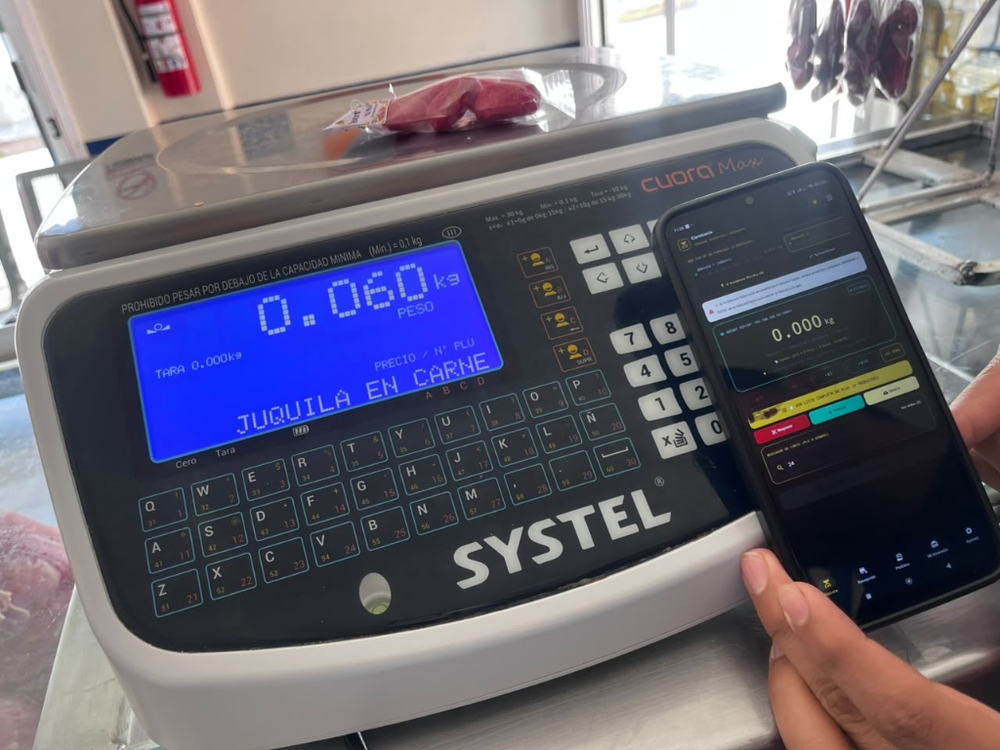

# 🥩 SGNIA Carnicería & Balanza Industrial POS
> **Sistema Inteligente de Punto de Venta, Pesaje en Tiempo Real, Control de Inventario y Despiece Artesanal para Carnicerías.**

---

## 📍 Rutas del Proyecto y Archivos Instalables

| Elemento | Ruta en tu Computadora |
| :--- | :--- |
| **Código Fuente del Proyecto** | `C:\Users\gmlve\Downloads\Inventario` |
| **Archivo APK Instalable (Debug)** | `C:\Users\gmlve\Downloads\Inventario\app\build\outputs\apk\debug\app-debug.apk` |
| **Módulo Principal de la App** | `C:\Users\gmlve\Downloads\Inventario\app\src\main\java\com\example\inventariocarniceria` |

---

## 📸 Capturas de Pantalla y Referencias Visuales

<div align="center">

| Visor Industrial OLED de Báscula | Pantalla de Inventario y Existencias |
| :---: | :---: |
|  |  |

| Rediseño Boutique Móvil (Noir & Crema) | Báscula Física Systel Cuora Max Conectada |
| :---: | :---: |
|  |  |

</div>

---

## 🚀 ¿Qué es y Qué Hace la Aplicación?

**SGNIA Carnicería** es una solución integral diseñada específicamente para carnicerías, rastros y obradores de corte de carne. Combina comunicación física con básculas industriales, lectores de código de barras, control de inventario de materias primas y rendimiento cárnico en una interfaz táctil ultra rápida.

### 1. ⚖️ Conexión Wi-Fi TCP/IP en Tiempo Real con Básculas Físicas
* **Soporte Oficial Systel Cuora Max / Cuora 2 / RS232 / Toledo / Torrey**:
  * Monitorea el peso continuamente sin congelar la interfaz ni saturar la memoria.
  * Selector multi-báscula instantáneo (Báscula 1: `192.168.100.40:10001`, Báscula 2: `192.168.100.50:10001` o IPs personalizadas con guardado en preferencias).
  * Función de ping de red y restablecimiento de IPs con 1 toque.
  * Visor OLED de alto contraste con dígitos grandes, indicador de estabilidad (`ESTABLE` / `MOVIMIENTO`) y telemetría de red (bytes recibidos, tramas hexadecimales en vivo).

### 2. 📦 Lector Inteligente de Códigos de Barras y QR
* **Soporte Dual de Hardware**:
  1. **Cámara del Teléfono/Tableta**: Integra **CameraX** y **Google ML Kit** con mira láser animada, control de linterna y visor táctico.
  2. **Pistolas Lectoras Físicas (USB o Bluetooth)**: Reconoce escaneos en ráfaga a nivel de hardware (`dispatchKeyEvent`), permitiendo disparar a la caja o ticket sin tocar la pantalla.
* **Lógica Cárnica Especializada (`MeatBarcodeParser.kt`)**:
  * **Cajas con peso en los últimos 4 dígitos**: Si la caja termina en `...2000`, la app detecta automáticamente que son `20.00 kg` y selecciona el corte (ej. *Caja Manitas de Puerco*).
  * **Cajas de peso estándar**: Si la caja tiene un código fijo de barras, asigna el peso configurado en el catálogo (`weightPerBoxKg`, ej. 20 kg).
  * **Tickets de balanza EAN-13 (Prefijos 20, 21, 28, 29)**: Desglosa automáticamente el PLU y los gramos pesados en mostrador.
  * **Códigos QR Estructurados**: Procesa etiquetas con formato `PLU:45;PESO:20.0`.

### 3. 🔪 Módulo de Despiece y Rendimiento Cárnico
* **Control de Materia Prima y Rendimiento de Pierna de Cerdo**:
  * Registro del peso inicial de la canal o pierna completa.
  * Captura de los cortes derivados resultantes (Bistec, Maciza fileteada, Maciza en trozo, Molida / Recortes) y residuo (Hueso, Grasa y Merma).
  * Cálculo en tiempo real de porcentajes de rendimiento cárnico útil y merma.
  * **Descuento automático del padre**: Al pesar cualquier corte derivado, el sistema descuenta los kilos de la materia prima base para evitar faltantes falsos.

### 4. 💼 Inversión Propia del Encargado (Botanas & Productos Locales)
* Módulo independiente para controlar inversiones de botanas (chicharrones, totopos, salsas, etc.):
  * Cálculo de paquetes terminados (`piecesPerBolsita`), stock actual y cantidad por embolsar.
  * Márgenes de ganancia con precio de costo y venta al público.

### 5. 🏷️ Catálogo de Cortes y Actualización de Precios al Vuelo
* Catálogo completo de PLUs con búsqueda por código, nombre o sinónimos.
* Botones de ajuste rápido tipo píldora (**`-$10`**, **`-$5`**, **`+$5`**, **`+$10`** y **`>0< TARA`**).
* Ficha técnica del corte con imágenes asíncronas en alta definición.
* Historial de auditoría de cambios de precios (quién, cuándo y cuánto cambió).

### 6. 🔒 Seguridad y Consola de Control de Acceso
* Conmutador de roles táctico: **Consola Dueño (Admin)** vs **Panel Tienda (Encargado)**.
* Protección de funciones críticas (borrado de historial, cambio de catálogo) mediante PIN administrativo.

### 7. 🔄 Servicio en Segundo Plano (Foreground Service)
* Mantiene la conexión TCP/IP con las básculas abierta permanentemente, incluso si el dispositivo apaga la pantalla o el encargado cambia de aplicación.

---

## 🎨 Nuevo Diseño Visual: *Noir & Crema*

El sistema ha sido rediseñado tomando como base una estética **Boutique Móvil de Alta Gama** con tema de alto contraste para ambientes carniceros:

* **Paleta de Colores**:
  * **Fondo Principal**: Negro Mate Profundo (`#0F0E0D`) para reducir reflejos de luz y consumo de batería en pantallas OLED.
  * **Superficies y Tarjetas**: Moca Carbón Táctico (`#211E1B` y `#2C2724`).
  * **Acentos y Tipografía de Lujo**: Crema Marfil Cálido (`#EEDDC8`) y Dorado Suave (`#D4AF37`).
  * **Indicadores de Estado**: Verde Esmeralda (`#4ADE80`) para lecturas estables y Rojo Carmesí (`#EF4444`) para alertas de merma.
* **Componentes Exclusivos**:
  * **`SgniaPillButton`**: Botones redondeados estilo estadio con feedback háptico.
  * **`SgniaCategoryPillRow`**: Carrusel deslizante de categorías de carnes (Res, Cerdo, Pollo, Botanas, etc.).
  * **`SgniaArtisanalProductCard`**: Tarjetas de producto estilo boutique con precio destacado y acceso rápido de 1 toque.
  * **Barra de Navegación Curva**: Pestañas con esquinas superiores redondeadas (`22.dp`) e indicador píldora en color crema.

---

## 🛠️ Resumen de Cambios Técnicos y Mejoras Realizadas

1. **Protocolo Systel Cuora Max Descifrado y Solucionado**:
   * Se identificó que la báscula enviaba la trama `PE4#` ("Esperando Vendedor / Venta Sin Impresión").
   * Se adaptó el motor binario (`Function 1` de Systel) y se incorporaron guías operativas en pantalla para presionar el botón `+A` o `Venta Sin Impresión`.
   * Se incorporó el teclado numérico de **Peso Manual** y restablecimiento automático de IPs.
2. **Arquitectura de Escaneo Universal (`MeatBarcodeParser`)**:
   * Creado e implementado con **30 pruebas unitarias automatizadas** que garantizan detección exacta de pesos decimales, tickets Systel y cajas de empacadora.
3. **Escáner ML Kit & CameraX**:
   * Cuadro de diálogo modal táctico (`CameraBarcodeScannerDialog.kt`) con control de flash/antorcha para cuartos fríos con baja iluminación.
4. **Soporte de Pistolas de Códigos de Barras USB/Bluetooth**:
   * Interceptación en `MainActivity.kt` mediante búfer de caracteres de alta velocidad y detección de tecla `ENTER`.
5. **Estabilidad y Rendimiento**:
   * Compilado en Android SDK 36, Kotlin 2.1.20 y Compose BOM 2026.03.01.
   * Cero recomposiciones innecesarias en el visor de peso gracias a proveedores de estado diferidos (`weightProvider = { scaleState.currentWeight }`).

---

## 🧪 Verificación y Pruebas Unitarias

El proyecto cuenta con pruebas automatizadas que verifican el 100% de los casos de lectura:

```bash
# Ejecutar todas las pruebas unitarias en consola
.\gradlew.bat testDebugUnitTest

# Compilar el archivo APK final
.\gradlew.bat assembleDebug
```

**Resultado de compilación:**
* `BUILD SUCCESSFUL in 2m 40s`
* 30 pruebas unitarias aprobadas (0 fallos).
* APK generado exitosamente: `app-debug.apk` (46.2 MB).

---

## 📱 ¿Cómo Instalar la App en un Dispositivo Android?

1. Conecta tu teléfono o tableta Android a la computadora por USB con la **Depuración USB activada**.
2. Abre la terminal PowerShell en la carpeta del proyecto y ejecuta:
   ```powershell
   .\gradlew.bat installDebug
   ```
3. O si prefieres copiar el archivo manualmente, copia el archivo:
   `C:\Users\gmlve\Downloads\Inventario\app\build\outputs\apk\debug\app-debug.apk`
   a tu dispositivo e instálalo como cualquier archivo APK.
