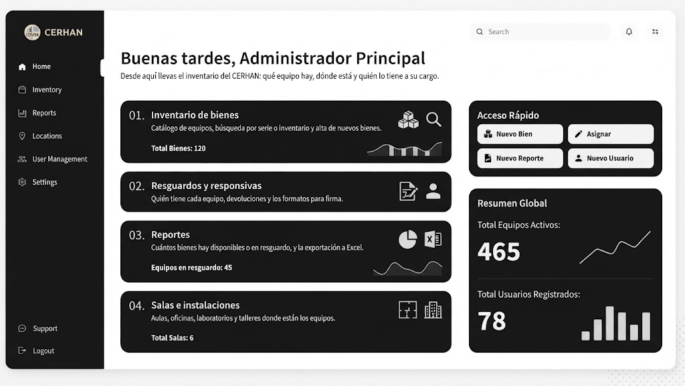
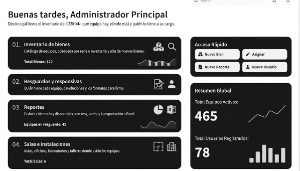

# 🥩 SGNIA Carnicería & Balanza Industrial POS
> **Sistema Inteligente de Punto de Venta, Pesaje Dual en Tiempo Real, Control de Inventario, Lector de Códigos de Barras/QR y Despiece Artesanal para Carnicerías.**

---

## 📍 Rutas del Proyecto y Archivos Instalables

| Elemento | Ruta en tu Computadora |
| :--- | :--- |
| **Código Fuente del Proyecto** | `C:\Users\gmlve\Downloads\Inventario` |
| **Archivo APK Instalable (Debug)** | `C:\Users\gmlve\Downloads\Inventario\app\build\outputs\apk\debug\app-debug.apk` |
| **Módulo Principal de la App** | `C:\Users\gmlve\Downloads\Inventario\app\src\main\java\com\example\inventariocarniceria` |
| **Video de Inicio (Splash)** | `C:\Users\gmlve\Downloads\Inventario\app\src\main\res\raw\logovideo.mp4` |
| **Ícono Oficial de la App** | `C:\Users\gmlve\Downloads\Inventario\app\src\main\res\drawable\logo.png` (y carpetas `mipmap-*`) |

---

## 📸 Capturas de Pantalla y Plantilla Visual Ejecutiva

<div align="center">

| Plantilla Ejecutiva: Menú Lateral Desplegable | Plantilla Ejecutiva: Tarjetas Numeradas y Básculas |
| :---: | :---: |
|  |  |

| Visor Industrial OLED de Báscula | Báscula Física Systel Cuora Max Conectada |
| :---: | :---: |
|  |  |

</div>

---

## 🚀 ¿Qué es y Qué Hace la Aplicación?

**SGNIA Carnicería** es una solución integral diseñada específicamente para carnicerías, rastros y obradores de corte de carne. Combina comunicación física TCP/IP con básculas industriales, lectores de código de barras (cámara y pistolas USB/Bluetooth), control de inventario de materias primas, rendimiento cárnico y consolidación multi-sucursal en una interfaz ejecutiva **Negro Mate & Crema Cálido**.

### 1. ⚖️ Panel de Tienda con Doble Báscula Simultánea en Tiempo Real
* **Pantalla Principal Unificada (`IndustrialScaleVisorScreen.kt`)**:
  * Muestra simultáneamente **ambas básculas en tiempo real** mediante tarjetas numeradas independientes:
    * **`01. Báscula 1 — Mostrador Principal`** (`192.168.100.40:10001` por defecto).
    * **`02. Báscula 2 — Corte y Despiece`** (`192.168.100.50:10001` por defecto).
  * Cada tarjeta cuenta con visor digital en color crema (`0.000 KG`), indicador de estado (`● ESTABLE` / `● LECTURA` / `● SIN SEÑAL`), selector de báscula activa, botón **`>0< TARA`** y captura rápida de peso.
  * **`03. Corte Activo y Captura`**: Selector de corte del catálogo con buscador instantáneo, botones rápidos de ajuste de precio (`-$10`, `-$5`, `+$5`, `+$10`), botón de **Escáner de Cámara (QR / Código de Barras)** y cálculo automático del importe total.
  * **`04. Sincronización de Red TCP/IP`**: Telemetría de paquetes recibidos, comando directo de prueba de red (`PING`), restablecimiento de IPs de fábrica con 1 toque y ajuste de IP/Puerto.
  * **`Acceso Rápido` (Cuadrícula 2x2 en Crema)** y **`Resumen Global`** con gráfica vectorial en vivo.

### 2. 🧭 Navegación Lateral Desplegable (`SgniaCerhanSidebar`) y Margen Seguro Superior
* **Protección Total de Barra de Estado (`systemBarsPadding()`)**:
  * Configurado desde la raíz en `MainActivity.kt` con fondo `#141312` para que **ninguna pantalla ni encabezado se encime con la hora, batería o notificaciones flotantes del teléfono**.
* **Sin Barras Rojas ni Menús Inferiores Estorbosos**:
  * Toda la navegación se concentra en un **Menú Lateral Izquierdo Desplegable (`ModalNavigationDrawer`)** activado desde el botón `☰ MENÚ` en la cabecera superior (`SgniaCerhanTopBar`):
    * **En la Consola del Dueño (`ADMIN`)**: Menú lateral con acceso directo a *Inicio / Resumen*, *Catálogo de Cortes*, *Unificación Pedidos*, *Sucursales y Tiendas*, *Proveedores*, *Seguridad y PIN* y *Cerrar Sesión*.
    * **En el Panel de Tienda (`ENCARGADO`)**: La pantalla principal muestra únicamente las **2 Básculas**, mientras que el menú desplegable lateral da acceso a *Recepción Mercancía*, *Pedidos de Surtido*, *Mi Inversión Local*, *Ajustes de Sistema* y *Cambiar Rol / Salir*.

### 3. 📦 Lector Inteligente de Códigos de Barras y QR
* **Soporte Dual de Hardware**:
  1. **Cámara del Teléfono/Tableta**: Integra **CameraX** y **Google ML Kit** (`CameraBarcodeScannerDialog.kt`) con mira láser animada y control de linterna para cuartos fríos.
  2. **Pistolas Lectoras Físicas (USB o Bluetooth)**: Reconoce escaneos en ráfaga a nivel de hardware (`dispatchKeyEvent` en `MainActivity.kt`), permitiendo disparar a la caja o ticket sin tocar la pantalla en **Básculas**, **Recepción de Mercancía** o **Catálogo**.
* **Lógica Cárnica Especializada (`MeatBarcodeParser.kt`)**:
  * **Cajas con peso en los últimos 4 dígitos**: Si la caja termina en `...2000`, la app detecta automáticamente que son `20.00 kg` y selecciona el corte (ej. *Caja Manitas de Puerco*).
  * **Cajas de peso estándar**: Si la caja tiene un código fijo de barras, asigna el peso configurado en el catálogo (`weightPerBoxKg`, ej. 20 kg).
  * **Tickets de balanza EAN-13 (Prefijos 20, 21, 28, 29)**: Desglosa automáticamente el PLU y los gramos pesados en mostrador.
  * **Códigos QR Estructurados**: Procesa etiquetas con formato `PLU:45;PESO:20.0`.

### 4. 🔪 Recepción de Mercancía, Despiece y Rendimiento Cárnico
* **Control de Materia Prima y Rendimiento de Pierna de Cerdo (`StockReceptionScreen.kt`)**:
  * Registro del peso inicial de la canal o pierna completa y recepción de cajas por código de barras.
  * Captura de los cortes derivados resultantes (Bistec, Maciza fileteada, Maciza en trozo, Molida / Recortes) y residuo (Hueso, Grasa y Merma).
  * Cálculo en tiempo real de porcentajes de rendimiento cárnico útil y alerta automática si la merma supera el umbral permitido (`4%`).
  * **Descuento automático del padre**: Al pesar cualquier corte derivado, el sistema descuenta los kilos de la materia prima base para evitar faltantes falsos.

### 5. 💼 Módulos Ejecutivos y Operativos Completos
* **Login y Bóveda de Seguridad (`SecurityVaultScreen.kt`)**: Selección de rol (*Consola Dueño* vs *Panel de Tienda*), selector de sucursal activa, ingreso de PIN con puntos indicadores en color crema (`#EEDDC8`) y teclado numérico táctil de alto contraste.
* **Consola Ejecutiva del Dueño (`ExecutiveOwnerDashboardScreen.kt`)**: Tarjetas numeradas (`01` a `04`) con inversión cárnica global, valor de venta proyectado, utilidad neta estimada, auditoría de mermas por sucursal, cuadrícula `Acceso Rápido` 2x2 y gráfica vectorial en `Resumen Global`.
* **Unificación de Pedidos (`MasterOrderUnificationScreen.kt`)**: Consolida automáticamente las solicitudes de todas las sucursales, calcula cajas sugeridas y genera el mensaje de pedido para WhatsApp con 1 toque.
* **Inversión Propia del Encargado (`ManagerInvestmentScreen.kt`)**: Control independiente para botanas y productos locales (chicharrones, manteca, carbón, salsas) con cálculo de bolsitas empacadas y margen de ganancia.
* **Catálogo, Sucursales, Proveedores y Seguridad (`AdminCatalogScreen`, `AdminBranchesScreen`, `AdminSuppliersScreen`, `AdminSecurityScreen`)**: Administración integral con diseño unificado.

### 6. 🎬 Video de Inicio Oficial e Ícono de Marca
* **Video Splash Screen (`SplashScreen.kt`)**: Al abrir la aplicación se reproduce a pantalla completa y sin bordes el video oficial `logovideo.mp4` mediante `VideoView` nativo, transicionando automáticamente al login al finalizar.
* **Ícono Oficial (`sglogo.png`)**: Integrado en todas las densidades de Android (`mipmap-mdpi` a `mipmap-xxxhdpi` e ícono adaptativo en `mipmap-anydpi-v26`) y en los encabezados de la aplicación.

---

## 🎨 Sistema de Diseño Ejecutivo: *Negro Mate & Crema Cálido*

El 100% de las pantallas utilizan los componentes de `SgniaComponents.kt` basados en la plantilla ejecutiva:

* **Paleta de Colores**:
  * **Fondo Principal**: Negro Carbón Mate (`#0F0E0D` / `#141312`).
  * **Superficies y Tarjetas Numeradas**: Carbón Ejecutivo (`#181715` / `#1C1B19`) con bordes sutiles (`#2A2723`).
  * **Acentos, Botones Principales y Selección Activa**: Crema Marfil Cálido (`#F3EFE6` / `#EEDDC8`) con texto en negro profundo (`#141312`).
  * **Indicadores de Estado**: Verde Esmeralda (`#4ADE80`) para lecturas estables, Ámbar (`#FBBF24`) para avisos y Rojo (`#F87171`) para alertas de merma.
* **Componentes Clave (`SgniaComponents.kt`)**:
  * **`SgniaCerhanTopBar`**: Cabecera superior con botón `☰ MENÚ`, subtítulo en mayúsculas, título principal en crema y badge de estado.
  * **`SgniaCerhanSidebar`**: Menú lateral izquierdo con perfil superior, píldora crema para la sección activa, badges numéricos y botón de salida.
  * **`SgniaNumberedCard`**: Tarjetas ejecutivas con índice numerado (`01.`, `02.`, `03.`, `04.`), badge de estado con punto luminoso y pie de acción.
  * **`SgniaQuickAccessGrid`**: Cuadrícula 2x2 de botones en color crema cálido con ícono circular oscuro.
  * **`SgniaGlobalSummaryCard`**: Panel inferior con métricas clave y gráfica de línea suavizada con relleno degradado.

---

## 🛠️ Resumen Cronológico de Cambios Realizados

1. **Adaptación Integral a la Plantilla Ejecutiva Negro & Crema**:
   * Rediseño completo de las 12 pantallas del sistema (`SecurityVaultScreen`, `ExecutiveOwnerDashboardScreen`, `IndustrialScaleVisorScreen`, `StockReceptionScreen`, `OrdersScreen`, `ManagerInvestmentScreen`, `SettingsScreen`, `AdminCatalogScreen`, `MasterOrderUnificationScreen`, `AdminBranchesScreen`, `AdminSuppliersScreen`, `AdminSecurityScreen`).
2. **Menú Lateral Izquierdo y Pantalla Principal de Doble Báscula**:
   * Eliminación de barras superiores rojas y barras inferiores.
   * Implementación de `ModalNavigationDrawer` con `SgniaCerhanSidebar` tanto para el Dueño como para el Encargado de Tienda.
   * Visualización simultánea de **Báscula 1 (`01.`) y Báscula 2 (`02.`)** en la pantalla principal de tienda.
3. **Corrección de Margen Superior (`systemBarsPadding`)**:
   * Aplicación de `Modifier.background(Color(0xFF141312)).systemBarsPadding()` en `MainActivity.kt` para evitar cualquier superposición con el reloj, batería o notificaciones del celular.
4. **Video de Inicio (`logovideo.mp4`) e Ícono Oficial (`sglogo.png`)**:
   * Sustitución de la animación anterior por el reproductor de video nativo en `SplashScreen.kt` y actualización de todos los recursos `mipmap`.
5. **Protocolo Systel Cuora Max + Escáner Universal de Códigos de Barras/QR**:
   * Decodificación de tramas TCP/IP en tiempo real, teclado de peso manual, escáner con cámara (`CameraX` + `ML Kit`) y soporte para pistolas lectoras USB/Bluetooth (`MeatBarcodeParser.kt` con 30 pruebas unitarias).

---

## 🧪 Verificación y Compilación

```powershell
# Ejecutar las 30 pruebas unitarias automatizadas
.\gradlew.bat testDebugUnitTest

# Compilar el archivo APK instalable
.\gradlew.bat assembleDebug
```

* **Estado de Compilación**: `BUILD SUCCESSFUL` (Kotlin 2.1.20, Android SDK 36, Compose BOM 2026.03.01).
* **Pruebas Unitarias**: 30 pruebas aprobadas en `MeatBarcodeParserTest.kt` (0 errores).

---

## 📱 ¿Cómo Instalar la App en un Dispositivo Android?

1. Conecta tu teléfono o tableta Android a la computadora por USB con la **Depuración USB activada** y ejecuta:
   ```powershell
   .\gradlew.bat installDebug
   ```
2. O copia directamente el archivo APK generado desde tu computadora a tu celular:
   `C:\Users\gmlve\Downloads\Inventario\app\build\outputs\apk\debug\app-debug.apk`
